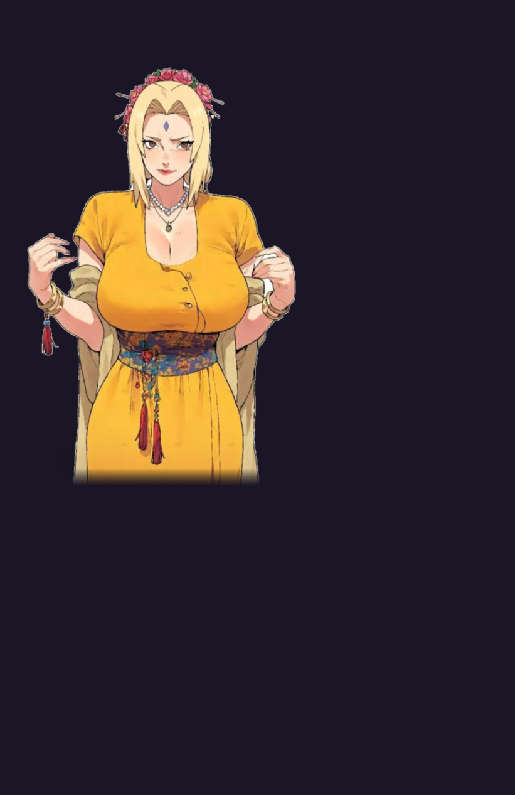
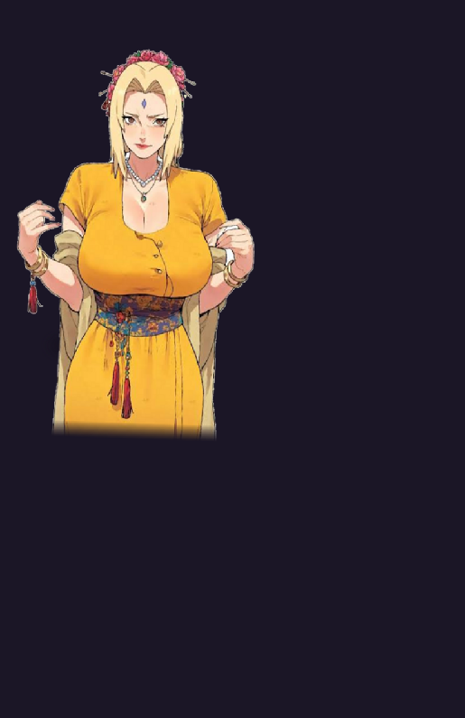
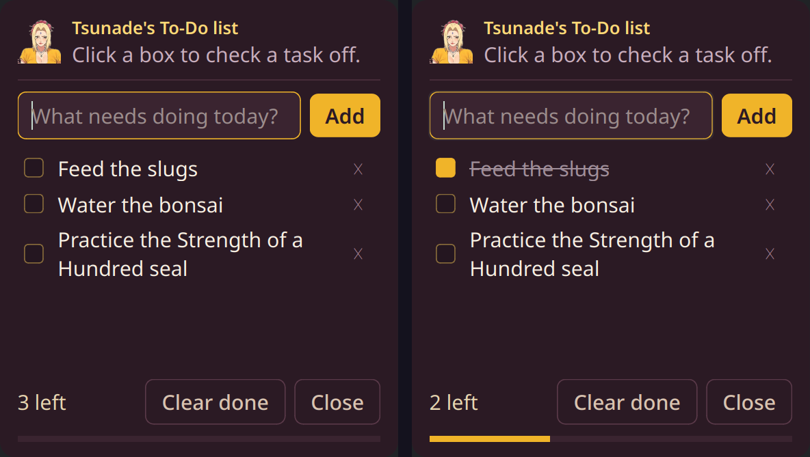

# Tsunade Pet

A cute, lightweight desktop companion built with **Python + PySide6 (Qt 6)**.
Tsunade (from the artwork you supplied) sits on your desktop as a borderless,
see-through sprite with hand-made animation generated from that single still
image, plus a to-do list she opens for you.

```
static pose for 5 s  ->  idle animation plays once  ->  back to the static pose
```

The animations are authored as PNG sprite sheets (`assets/sheet_*.png`) because
that keeps her edges crisp at any size; the same animations are also written out
as transparent GIFs (`assets/anim_*.gif`) for viewing and sharing.

| Resting | Mid-reaction | To-do list |
| --- | --- | --- |
|  |  |  |

## What she does

| Interaction | Result |
| --- | --- |
| **Launch** | She appears bottom-right of your screen: no window frame, no taskbar entry, always on top. She holds the pose for 5 s, breathes once, and settles back. |
| **Drag her** | Grab anywhere on her and move her around; the new spot is remembered. |
| **Single click** | She reacts — jiggles, turns around, hops or shakes her head — and says something. The moves cycle so you never get the same one twice in a row. |
| **Double click** | Opens her to-do list. |
| **Mouse wheel** | Resizes her (150–900 px tall), anchored at her feet. 484 px is the default. |
| **Right click** | Menu: to-do list, do something cute, always-on-top, speech bubbles, click reactions, idle animations, size presets, reset position, hide, quit. |
| **Tray icon** | Show/hide her, open the to-do list, quit. |

Between animations she stands still; her idle "breath" repeats every 18 s (this,
the 5 s pause, the scale and the animations themselves are all configurable in
`~/.config/tsunade-pet/config.json`, or toggle them from the right-click menu).

### The to-do list

* Tasks are sorted into lists. The tabs across the top are **All** (everything
  at once) and one tab per list; **+ List** creates a new one, and each task's
  **⇄** button moves it to another list.
* **− List** deletes the list you are looking at together with everything in
  it — it asks first and says how many tasks will go. The last remaining list
  cannot be deleted.
* Add a task (**Enter** or **Add**), it is saved immediately. From the *All*
  tab, the small picker next to the box chooses which list it lands in.
* Tick a task to check it off — finished tasks are struck through and counted.
* Delete any task with the **✕** button, or select it and press **Delete**.
* **Clear done** removes the finished tasks in the view you are looking at; the
  counter and progress bar follow the tab.
* **Esc** or **Close** hides the window (she stays on your desktop).
* Everything lives in `~/.config/tsunade-pet/todos.json`. If that file is ever
  damaged it is kept as `todos.json.corrupt` and she starts from an empty list
  instead of crashing.

## Requirements

* Python 3.9+ with `PySide6` (tested on Python 3.14 / PySide6 6.11 / Fedora 44 KDE).
* `Pillow` — only to regenerate the artwork, not to run the app.

```bash
sudo dnf install python3-pyside6        # or: pip install -r requirements.txt
```

## Running

```bash
./run.sh                 # or: python3 -m tsunade_pet
```

To keep her one launch away and/or have her start with your session:

```bash
tools/install_desktop_entry.sh              # adds a "Tsunade Pet" launcher
tools/install_desktop_entry.sh --autostart  # ...and starts her with your session
```

Quit from the tray icon or her right-click menu. Only one pet can run at a time
(a lock file guards against accidental doubles).

## How the animation is made

The source picture is one flat illustration, so every animation is an affine
warp of the cut-out figure — squash, stretch, rotate, hop, and a mirror-flip
"turn around" — rendered frame by frame together with a soft contact shadow:

```
assets/source/tsunade.png      the artwork you gave me
        |
        v  tools/build_assets.py
assets/tsunade_sprite.png      resting pose, backdrop removed, shadow baked in
assets/sheet_<name>.png        one horizontal strip of frames per animation
assets/anim_<name>.gif         the same animation as a shareable GIF
assets/tsunade_mask.png        silhouette of every frame (the window shape)
assets/sheets.json             frame counts, timings and cell geometry
```

Regenerate after editing the source art (about 30 s):

```bash
python3 tools/build_assets.py
```

The build tool keys out the white backdrop by flood-filling inwards from the
border (so white details *inside* the figure survive), removes the white matte
from the soft edges so there is no pale halo, paints out the watermark in the
bottom-left of the source, and fades the last few pixels so she melts into
whatever is behind her.

Two details matter for how she looks once the app scales her:

* Every pixel behind the visible ones carries the colours of the nearby art
  rather than black (``bleed_edges``). Straight-alpha scaling drags whatever is
  under a transparent pixel into the silhouette, so black there paints a dark
  rim around her that gets worse the further she is scaled from her natural
  size.
* ``tsunade_mask.png`` is the union of *every* frame's silhouette. The app hands
  it to the window manager as the window's shape so clicks in the empty area
  reach your desktop — using the resting pose alone would clip her head off
  mid-hop and swallow her ground shadow.

`assets/preview.html` shows the cut-out, every GIF and every frame of every
sheet — handy for judging a change to the animation curves.

Animations are authored at 720 px tall so she stays crisp on HiDPI screens
(this machine runs at 1.6×, so she is drawn from ~1:1 pixels). Sprite sheets are
sliced lazily and only two animations are kept in memory at a time.

## Layout

```
run.sh                     launcher
tsunade_pet/
  app.py                   platform choice, single instance, tray icon, wiring
  pet.py                   the frameless sprite window, drag/click/wheel, actions
  animations.py            frame-by-frame player over the sprite sheets
  assets.py                sheet metadata, lazy slicing, LRU of decoded frames
  todo.py                  the to-do store (plain Python) and its window
  config.py                settings + atomic JSON writes
tools/
  build_assets.py          artwork pipeline (backdrop removal, poses, GIFs)
  smoke_test.py            drives the real app on the desktop and checks behaviour
  install_desktop_entry.sh launcher / autostart installer
tests/                     unit tests: to-do store, artwork, build tool
```

## Tests

```bash
python3 -m unittest discover -s tests -t .   # 52 checks, no desktop needed
python3 tools/smoke_test.py                  # 60 checks driving the real app
```

The smoke test uses your real desktop for about a minute: it starts the pet,
waits out the 5 s static pose, watches it animate and settle, clicks it, drags
it, resizes it, double-clicks it open, exercises the to-do list, and writes
screenshots to `/tmp/tsunade-pet-smoke/`. Feel free to poke her while it runs.

## Notes and troubleshooting

* **Linux/Wayland:** a native Wayland client is not allowed to position its own
  windows, so dragging would silently do nothing. When both `WAYLAND_DISPLAY`
  and `DISPLAY` are set the app therefore runs on XWayland (`xcb`), which
  supports dragging and always-on-top. Override with
  `TSUN_PET_PLATFORM=wayland` (or `xcb`, `x11`) if you want something else.
* **Screenshots:** some Wayland screen-capture tools skip XWayland surfaces
  (spectacle does here), so a capture may not show her even though she is on
  screen. `xprop -name "Tsunade Pet"` shows the window's real state.
* **Where things live:** settings and the to-do list are in
  `~/.config/tsunade-pet/` (`TSUN_PET_HOME` overrides it). Artwork is looked up
  next to the code; `TSUN_PET_ASSETS` overrides that.
* **She is missing** (tray-only state): click the tray icon, or delete
  `~/.config/tsunade-pet/pet.lock` if a previous run crashed hard.
